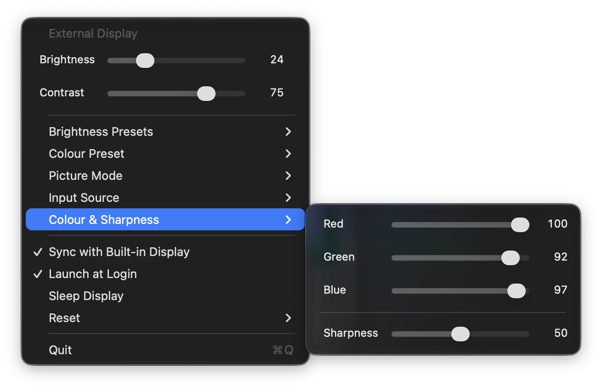
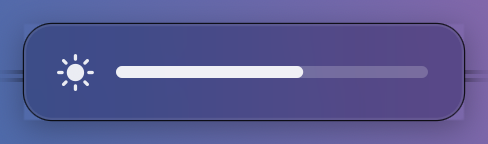

# Mac Monitor Controller

A menu bar app for controlling an external monitor from your Mac: brightness, contrast, colour and input.



## Features

- Brightness and contrast sliders, plus brightness presets
- Brightness keys control the monitor when the laptop lid is closed, with an on-screen overlay. Option+Shift gives finer steps
- Sync with Built-in Display: when it's on, a brightness change on either screen carries over to the other
- Colour presets, picture modes, and sliders for red, green, blue and sharpness
- Input switching between USB-C / Thunderbolt, DisplayPort and HDMI
- Picks up brightness changes made with the monitor's own buttons
- Sleep display, launch at login, and resets for the monitor's settings



## Install

You need an Apple silicon Mac on macOS 13 or later, and a monitor that supports DDC/CI, the standard for changing a monitor's settings from a computer.

1. Download the zip from the [releases page](https://github.com/jjohnson1994/mac-monitor-control/releases/latest), unzip it and move the app to Applications.
2. Open it. The app isn't signed with an Apple developer account, so macOS blocks it the first time. Go to System Settings > Privacy & Security and click Open Anyway.
3. A sun icon appears in the menu bar.
4. For the brightness keys, allow Accessibility access when macOS asks. If you dismissed the prompt, choose Enable Brightness Keys… from the menu.

## Limitations

- Built for a Dell U2725QE. The colour preset, picture mode and input lists come from that monitor, so they may not match yours.
- Controls one external monitor: the first one it finds.
- N/A next to a slider means no monitor was found. A ? means the monitor didn't answer for that setting.

## Building

You need the Xcode command line tools.

```
./build.sh
```

The app ends up in `build/External Brightness.app`.
